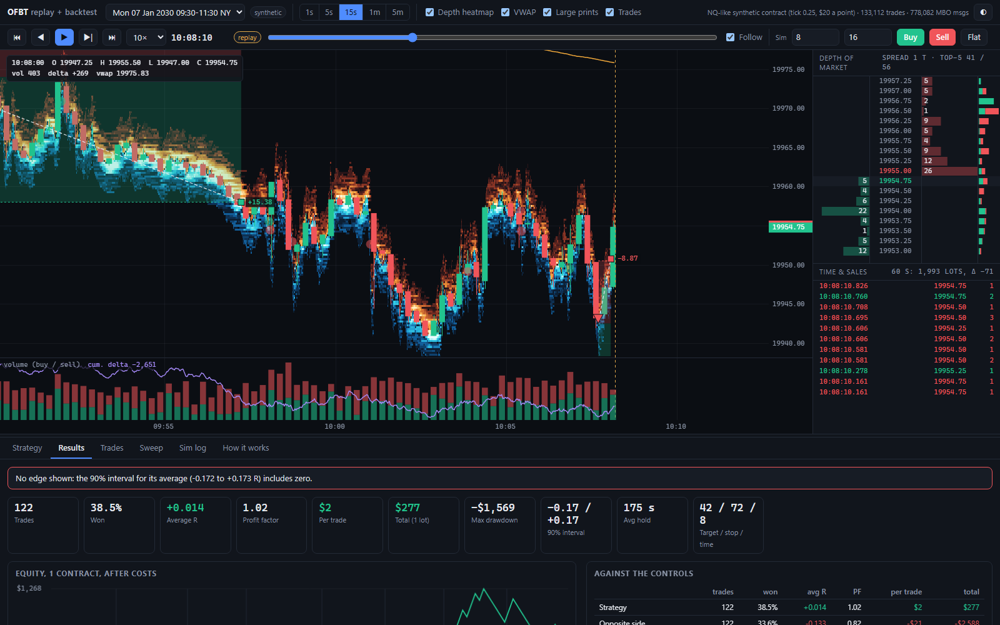
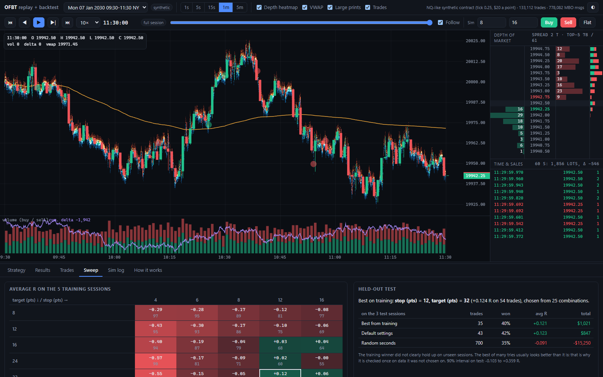
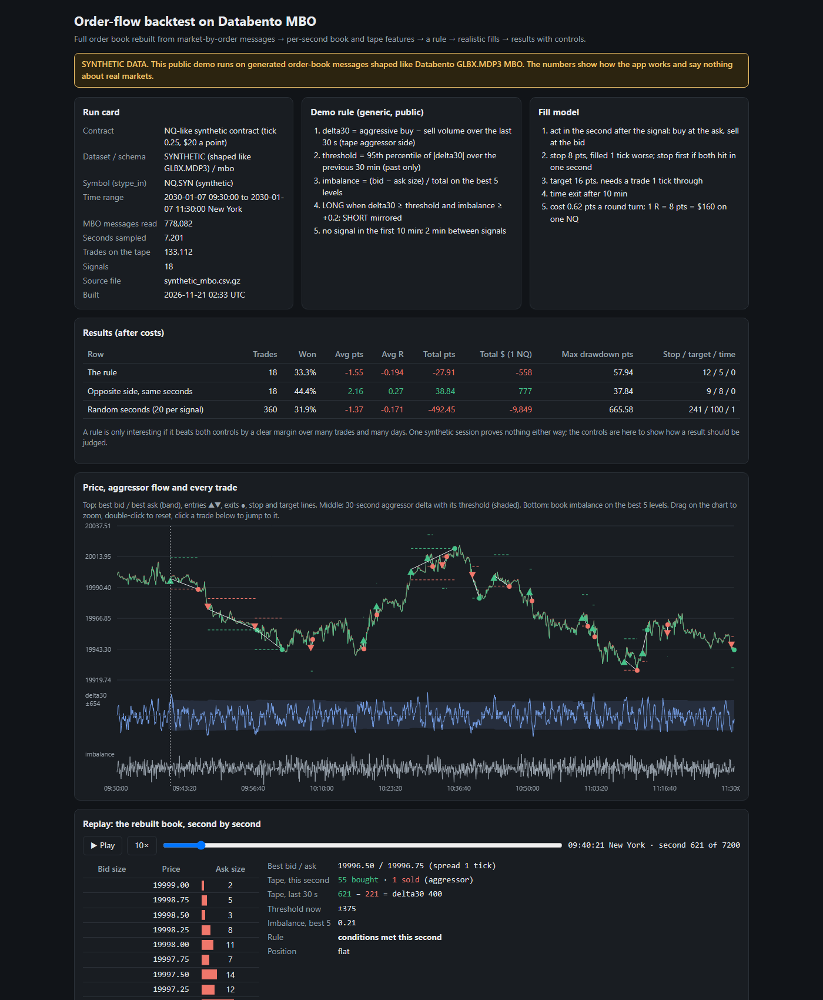

# Order-flow replay and backtest lab on Databento MBO

A research tool for futures order flow. It reads Databento **market-by-order (MBO)** data, rebuilds the full CME order book message by message, and stores each session as per-second book snapshots, a depth heatmap and the full tape. On top of that it gives you:

- a **replay terminal** in the browser: candles built from the tape, a Bookmap-style depth heatmap, VWAP, large prints, volume by aggressor, cumulative delta, a depth-of-market ladder and time & sales. In replay, everything after the cursor is hidden, and you can paper-trade with the same fill model as the backtester;
- an **event-driven backtester** in Python: strategies see one second at a time, orders fill in the next second with conservative fills, and every result is compared with two controls (the opposite side, and random entries);
- **walk-forward parameter sweeps**: a grid is searched on training sessions and the winner is scored once on held-out sessions.

The public demo runs on **synthetic** MBO data, so you can run it without a Databento account. No licensed data is redistributed.



---

## Run it (under 5 minutes)

You need Python 3.10 or newer.

**1. Fastest result (about 10 seconds):**

```bash
pip install -r requirements.txt
python run_demo.py
```

This generates one synthetic session, rebuilds its order book, runs the demo rule with the fill model and controls, and writes **`out/report.html`**, which opens in your browser. The report is a single offline file: run details, results against the controls, a chart of every trade and a second-by-second replay of the book. If it does not open by itself, open `out/report.html`.

**2. The tests:**

```bash
python -m ofbt build --sessions 1     # one synthetic session (about 10 s); the engine test needs it
python tests/test_book.py             # book rebuild on hand-written messages with a known answer
python tests/test_engine.py           # no look-ahead, and the engine matches the report's trades
python tests/test_rolls.py            # the contract-roll case study (no session needed)
```

**3. The full app:**

```bash
python -m ofbt build      # 8 synthetic sessions (about 1.5 minutes; reuses any already built)
python -m ofbt serve      # opens http://127.0.0.1:8765
```

In the app, press **Run backtest**, then click any trade to see it on the chart or press **▶ replay** to watch it second by second. Press <kbd>Home</kbd> then <kbd>Space</kbd> to replay a session from the open. The **How it works** tab lists every control.

From the terminal:

```bash
python -m ofbt backtest delta_momentum                         # the same backtest in the terminal
python -m ofbt backtest vwap_reversion --set z=2.5 stop_pts=6  # override parameters
python -m ofbt rollcase                                        # the contract-roll case study, step by step
```

**Troubleshooting case study:** [docs/case_study_roll.md](docs/case_study_roll.md) works through a real 294.50-point futures roll mismatch between two data sources: the symptom, why a price-gap check missed it, how comparing the sources found it, and the fix, reproduced on synthetic data.

## What the app shows

| Area | What it is |
|---|---|
| Chart | Candles from the tape (1 s to 5 min). Behind them, the **depth heatmap**: resting size on every price within 50 ticks of the mid, every second, blue for bids and orange for offers. VWAP, large prints (seconds with unusually high volume, coloured by aggressor), backtest and sim trades with their stop and target zones. Wheel to zoom, drag to pan, drag the price axis to scale. |
| Lower pane | Volume split into buyer- and seller-initiated, and cumulative delta. |
| Depth of market | The rebuilt book at the replay second: size at each price, best bid and ask, and traded volume at each price over the last 60 s. |
| Time & sales | Every print up to the replay second, with the aggressor side; large prints in bold. |
| Replay | Play, pause, step by second or by bar, 1× to 300×. Data after the cursor is not drawn. **Sim** Buy / Sell / Flat trade with the backtester's fill model, computed in the browser. |
| Strategy | Pick a strategy, edit its parameters (generated from the strategy's own spec), pick sessions, run. |
| Results | Verdict, trades, win rate, average R, profit factor, expectancy, max drawdown, a 90% bootstrap interval by session, the equity curve, the comparison with both controls, and results by session. |
| Sweep | One or two parameters on a grid over the training sessions, shown as a heatmap of average R; the best cell is then run once on the held-out sessions, next to the default settings and random entries. |



## The example run

**Static report** (`python run_demo.py`): one synthetic session, seed 7.

| | |
|---|---|
| **Futures contract** | NQ-like synthetic contract: E-mini Nasdaq-100 conventions, tick 0.25, $20 a point |
| **Data** | 778,083 synthetic MBO messages in Databento's `mbo` layout (R clear, A add, C cancel, M modify, T trade, F fill), generated by `ofbt/synth.py` with seed 7 |
| **Time range** | 2030-01-07 09:30:00 to 11:30:00 New York. The date is deliberately fake. |
| **Rebuilt** | 7,201 one-second book snapshots, 133,112 trades on the tape |
| **Result after costs** | the demo rule: 18 trades, 33% won, −0.19 R a trade. Opposite side at the same seconds: +0.27 R. Random seconds (360 trades): −0.17 R |



**The app** (`python -m ofbt build`): 8 synthetic sessions, seeds 7 to 14, 2030-01-07 to 2030-01-16, 09:30 to 11:30 New York each. Every built-in strategy with its default settings on all 8:

| Strategy | Trades | Won | Avg R | Opposite side | Random entries | 90% interval for avg R |
|---|---:|---:|---:|---:|---:|---|
| Delta momentum | 122 | 38.5% | +0.01 | −0.13 | −0.09 | −0.17 to +0.17 |
| VWAP reversion | 97 | 46.4% | −0.13 | −0.09 | −0.25 | −0.27 to +0.02 |
| Opening-range breakout | 13 | 30.8% | −0.16 | +0.31 | +0.02 | −0.84 to +0.54 |
| Top-of-book queue imbalance | 205 | 43.9% | −0.27 | −0.24 | −0.27 | −0.32 to −0.22 |
| Large-print follow | 124 | 24.2% | −0.37 | +0.02 | −0.09 | −0.57 to −0.19 |
| Random entry (baseline) | 88 | 33.0% | −0.11 | −0.01 | −0.08 | −0.39 to +0.17 |
| EMA cross (user example) | 79 | 30.4% | −0.19 | +0.04 | −0.05 | −0.34 to +0.01 |

**How to read this:** none of these shows an edge, which is the expected answer. The synthetic price is a random walk, so nothing in it can be predicted for long. The small-bracket queue strategy loses about the cost of trading on every trade. The table shows the machinery working end to end, with results judged against controls and an honest interval. It is not evidence about any market.

## The strategies

All of these are generic textbook ideas, written to show the engine. They are not anyone's trading strategy, and none was tuned.

| Name | Idea |
|---|---|
| `delta_momentum` | Follow aggressive flow when the book agrees: aggressor delta over the last N s above its own recent percentile, and top-of-book depth leaning the same way. Its defaults are the rule in the static report, and `tests/test_engine.py` checks that the engine reproduces the report's trades. |
| `vwap_reversion` | Fade stretches of more than z standard deviations from the session VWAP. |
| `opening_range` | Break of the first N minutes' high or low; one trade each way per session. |
| `queue_imbalance` | Spread of one tick and most of the inside size on one side for several seconds in a row. |
| `sweep_follow` | A second with unusually high volume that is mostly one-sided: trade with the aggressors. |
| `random_entry` | A coin flip every N minutes. Any idea has to beat this. |
| `ema_cross` | In `user_strategies/`: an example of adding your own. |

### Writing your own

Drop a file in `user_strategies/`. It appears in the app the next time the strategy list loads, with a form built from its `params`.

```python
from ofbt.engine import Param, Strategy

class EmaCross(Strategy):
    name = "ema_cross"
    title = "EMA cross"
    description = "Buy when a fast EMA of the mid crosses above a slow one, sell on the cross below."
    params = dict(fast_s=Param(60, 5, 600, 5, "fast EMA (s)"), slow_s=Param(600, 30, 3600, 30, "slow EMA (s)"),
                  stop_pts=Param(10.0, 1.0, 40.0, 0.5, "stop (pts)"), target_pts=Param(20.0, 1.0, 80.0, 0.5, "target (pts)"))

    def on_start(self, ctx):
        self.f, self.s = ctx.F.ema(self.p["fast_s"]), ctx.F.ema(self.p["slow_s"])

    def on_second(self, ctx):                      # called at the END of every second; ctx.i is that second
        i = ctx.i
        if i > self.p["slow_s"] and (self.f[i] > self.s[i]) != (self.f[i - 1] > self.s[i - 1]):
            side = ctx.buy if self.f[i] > self.s[i] else ctx.sell
            side(self.p["stop_pts"], self.p["target_pts"], 1200, "cross")
```

`ctx.F` (in `ofbt/features.py`) has the per-second building blocks: bid, ask, mid, spread, volume, buyer and seller volume, delta, cumulative delta, VWAP, last price, rolling delta and volume sums, past-only percentiles, book imbalance over N levels, rolling highs and lows, the standard deviation of the mid, and EMAs. Every value at index `i` uses only data known at the end of second `i`; `ctx.book()` gives the ladder at the current second.

## Fill model (`ofbt/backtest.py`, used by the engine, the report and the browser sim)

- An order decided at the end of second *s* is filled in second *s*+1: buy at the ask, sell at the bid. You pay the spread.
- **Stop:** filled 1 tick worse than the stop price.
- **Target:** fills only if price trades 1 tick through it. A touch is not a fill.
- If the stop and the target are both reachable within one second, the stop is assumed to come first.
- **Time exit** after the strategy's maximum hold, at the bid (long) or ask (short). Positions are flat at the end of the session.
- **Costs:** 0.62 points a round turn. One position at a time; an order sent while a position is open is rejected.
- **Controls**, using the same brackets: OPPOSITE takes the other side at the same seconds; RANDOM takes the same bracket at 20 random seconds per trade, from the part of the session where the strategy could trade.
- **Interval:** a 90% bootstrap interval for the average R. With 3 or more sessions it resamples whole sessions, because trades on the same day are not independent.

## How it fits together

```
 Databento MBO file (.dbn.zst)           synthetic MBO (.csv.gz)
 ofbt/loaders.py: load_dbn()             ofbt/synth.py + loaders.py: load_synthetic()
            \                                   /
          numpy record arrays with Databento's MBO field names (same shape for both)
                               |
 ofbt/book.py: rebuild()     order-by-order book: A/C/M/R update resting orders, T is the tape,
                             F is ignored for depth (the C or M that follows carries it);
                             sampled every second: best bid/ask, 10-level ladder, per-second trade
                             high/low for fills, and resting size on 101 ticks around the mid
                               |
 ofbt/store.py               one compressed .npz per session + a JSON card  (data/sessions/)
                               |
          +--------------------+--------------------------+
          |                                               |
 ofbt/features.py, engine.py,                   ofbt/server.py (standard library HTTP)
 strategies.py, metrics.py                       /api/session/<id>/sec.bin | heat.bin | tape.bin
 backtest, controls, bootstrap, sweep            /api/strategies, /api/backtest, /api/sweep
          |                                               |
 python -m ofbt backtest ...                    web/ (canvas app, no build step, no dependencies)
```

`run_demo.py` is the original one-file pipeline (`ofbt/rule.py` + `ofbt/report.py`); it writes `out/report.html`, which runs offline with no server.

## Real Databento data

**Dataset and schema used:** `GLBX.MDP3` (CME Globex MDP 3.0), schema **`mbo`**, symbol **`NQ.v.0`** with `stype_in="continuous"`. That is the NQ front month, rolled by volume. One file per trading day was downloaded, starting at 00:00 UTC so that the file opens with the full book snapshot.

**Download** (needs your own key in the environment variable `DATABENTO_API_KEY`; it is never written in code):

```python
import databento as db
client = db.Historical()                      # reads DATABENTO_API_KEY from the environment
q = dict(dataset="GLBX.MDP3", schema="mbo", symbols=["NQ.v.0"], stype_in="continuous",
         start="2026-10-15T00:00", end="2026-10-15T16:00")
print(client.metadata.get_cost(**q))          # always check the price first
client.timeseries.get_range(**q, path="NQ-mbo-20261015.dbn.zst")
```

**Load it into the app:**

```bash
pip install databento
python -m ofbt build --dbn NQ-mbo-20261015.dbn.zst --from 09:30 --to 16:00
python -m ofbt serve
```

The code that loads the data is `ofbt/loaders.py`, `load_dbn()`. It uses `databento.DBNStore.from_file(path).to_ndarray(count=...)` to stream the file in 1-million-record chunks, because a full NQ day is tens of millions of messages, which is too big for one DataFrame. `ofbt/store.py`, `build_dbn()` turns it into a session. Sessions built from real data are saved under `private_data/`, which git ignores, and are marked private in the app: licensed data must not be shared. `python run_demo.py --dbn FILE` does the same for the static report and writes to `private_out/`.

## Verification

1. **Book rebuild, known answer:** `tests/test_book.py` feeds hand-written A / M / C / T / F messages and checks the best bid and ask, ladder sizes, tape and fill prices.
2. **No look-ahead:** `tests/test_engine.py` cuts a session at several seconds, recomputes every feature on the cut session and checks that it equals the full-session feature up to the cut.
3. **Engine parity:** the same test checks that the engine running `delta_momentum` gives exactly the trades of the static report's rule (after dropping the report's overlapping trades, since the engine holds one position at a time).
4. **Browser sim parity:** a sim long at 09:55:00 on the seed-7 session, with an 8-point stop and 16-point target, filled at 19962.50 and stopped out at 19954.25 at second 1,685 (−8.87 points after costs). `backtest.simulate()` in Python gives the same entry, exit and second.
5. **Real-data cross-check (done locally, data not included):** on the real `GLBX.MDP3 mbo NQ.v.0` file for 15 Oct 2026, 09:30 to 11:30 New York, this app's Python book was compared second by second with an independent C implementation of the same rebuild. The rebuild read 21.9 million MBO messages for that window. The match was exact:
   - best bid and best ask equal on 7,200 of 7,200 seconds;
   - size at the best bid and best ask equal on 7,200 of 7,200 seconds;
   - the tape matched to the contract: 230,711 trades, 300,147 contracts, and 152,171 contracts bought by aggressors in both.
6. **Reproducible:** seed 7 gives the same 778,083 messages and the same trades on every run.
7. **Contract rolls:** `tests/test_rolls.py` reproduces the roll case study on synthetic data. A gap screen misses the hidden switch, the source comparison finds it, the spread comes out at exactly 294.50, and after back-adjustment the two sources agree to the tick.

## Limitations

- **Synthetic data is a toy.** A hidden fair price follows a random walk with volatility bursts. Simple liquidity providers quote around it, and takers trade when it moves through the inside. Spread (1 tick median), depth near the inside and volume are in a plausible range for NQ, but nothing was calibrated to real data. There are no news events, opening auction or session structure. Any pattern found in it is a property of the simulator.
- **Fills:** one contract at the best bid or ask. No queue position for limit orders, no market impact, no sweeping several levels for size. The 1-tick stop slippage is conservative in quiet markets and kind in fast ones.
- **Once-a-second sampling.** Decisions and exits happen at second boundaries; order inside a second is approximated (stop first). The tape keeps every print with its millisecond time, but the book is sampled once a second.
- **Depth heatmap:** 50 ticks either side of the mid; sizes above 65,535 are capped.
- **Timestamps:** the book uses `ts_recv`, Databento's receive time, not `ts_event`. Real latency to an exchange and to a trading platform is not modelled.
- **Contract rolls:** `NQ.v.0` switches contracts on the roll. Backtests here run one session at a time, so they are not affected, but a multi-day study must not compare prices across a roll without adjusting them. Each session records its `instrument_id`, and `ofbt/rolls.py` has the tools; see [the case study](docs/case_study_roll.md).
- **Statistics:** 8 two-hour sessions are few. A sweep over many settings will always find a cell that looks good on the training sessions; the held-out test is the honest number, and it is still small. A real study needs many more days, and the settings must be chosen on one period and confirmed once on another.
- **Single user, local:** the server binds to 127.0.0.1 and runs user strategy files as normal Python code. It is not built to be exposed to a network.

## Layout

```
ofbt/config.py          every setting (dataset, schema, demo rule, bracket, costs)
ofbt/synth.py           synthetic MBO generator (seeded)
ofbt/loaders.py         load_dbn() for real Databento files, load_synthetic() for the demo files
ofbt/book.py            MBO -> order book -> per-second snapshots, depth heatmap, tape
ofbt/store.py           build, save, list and load sessions
ofbt/features.py        per-second features, past-only
ofbt/engine.py          Strategy base class, event loop, controls, backtest_run(), sweep()
ofbt/strategies.py      built-in example strategies + the registry (loads user_strategies/)
ofbt/metrics.py         statistics, equity curve, session bootstrap
ofbt/backtest.py        the fill model (shared by everything)
ofbt/rolls.py           contract-roll tools (switch detection, source comparison, spread, back-adjustment) + the case study
ofbt/server.py          local HTTP server and JSON / binary API
ofbt/__main__.py        command line: build, serve, backtest, list, rollcase
ofbt/rule.py, report.py the static one-session report used by run_demo.py
web/                    the browser app (index.html, app.js, style.css)
user_strategies/        your strategies; ema_cross.py is an example
tests/                  book rebuild, engine and roll tests
run_demo.py             one command: synthetic static report, or --dbn for a real file
docs/                   screenshots and the roll case study
```

## Not in this repository, on purpose

API keys and credentials, raw Databento files, sessions or results computed on real data, and private strategy rules.
