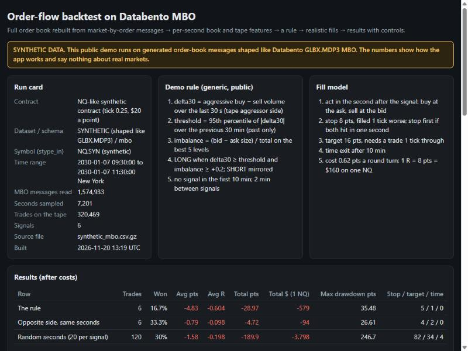
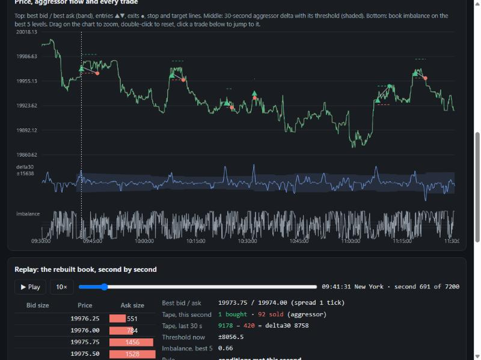

# Order-flow backtest on Databento MBO

A small, self-contained backtesting app for futures order flow. It reads Databento **market-by-order (MBO)** data, rebuilds the full CME order book message by message, samples the book and the tape once per second, applies a rule, fills trades with a conservative fill model, and writes one HTML report. The report has the run details, results against two controls, a chart of every trade and a second-by-second replay of the rebuilt book.

The public demo runs on **synthetic** MBO data, so you can run it without a Databento account. No licensed data is redistributed.




---

## Run it (under 5 minutes)

You need Python 3.10 or newer.

```bash
pip install -r requirements.txt
python run_demo.py
```

The run takes about 25 seconds. It writes `out/report.html` and opens it in your browser. The report is a single offline file with no server and no internet. To skip running it, look at the two screenshots above.

Check the book rebuild on hand-written messages with a known answer:

```bash
python tests/test_book.py
```

## What the example run is

| | |
|---|---|
| **Futures contract** | NQ-like synthetic contract: E-mini Nasdaq-100 conventions, tick 0.25, $20 a point |
| **Data** | 1,574,933 synthetic MBO messages in Databento's `mbo` layout (A add, C cancel, M modify, R clear, T trade, F fill), generated by `demo/synth.py` with seed 7 |
| **Time range** | 2030-01-07 09:30:00 to 11:30:00 New York. The date is deliberately fake. |
| **Rebuilt** | 7,201 one-second book snapshots, 320,469 trades on the tape |
| **Rule** | 6 signals (rule below) |
| **Result after costs** | rule: 6 trades, 1 won, -4.83 pts a trade (-0.60 R). Opposite side at the same seconds: -0.10 R. Random seconds with the same bracket (120 trades): -0.20 R |

**How to read the result:** the synthetic fair price is a random walk, so by construction nothing can be predicted. Six trades on one session is noise. The run demonstrates the machinery: data in, book rebuilt, rule applied, honest fills, results judged against controls. It is not evidence about any market.

## The demo rule

This is a generic textbook order-flow momentum rule. It is not anyone's trading strategy. It is evaluated at the end of every second, using only information known by then:

1. `delta30` = aggressive buy volume minus aggressive sell volume over the last 30 s, from the trade's aggressor side.
2. `threshold` = 95th percentile of `|delta30|` over the previous 30 minutes. This uses the past only, and is relative to the current market rather than a fixed lot size.
3. `imbalance` = (bid size minus ask size) divided by their total, over the best 5 price levels of the rebuilt book.
4. **LONG** when `delta30 ≥ threshold` and `imbalance ≥ +0.20`. **SHORT** is the mirror.
5. There is no signal in the first 10 minutes, while the threshold builds its history, and there are at least 2 minutes between signals.

All settings are in `demo/config.py`.

## Fill model (`demo/backtest.py`)

- The trade is placed in the second after the signal: buy at the ask, sell at the bid. You pay the spread.
- **Stop:** 8 points, filled 1 tick worse than the stop price.
- **Target:** 16 points. It fills only if price trades 1 tick through the target.
- If the stop and the target are both reachable within one second, the stop is assumed to come first.
- **Time exit:** after 10 minutes. **Costs:** 0.62 points a round turn. 1 R = 8 points = $160 on one NQ.
- **Controls**, using the same bracket:
  - OPPOSITE: the other side at the same seconds.
  - RANDOM: 20 random seconds per signal (seeded).

  A rule only matters if it beats both controls over many trades and many days.

## How the app produces results

```
 Databento MBO file (.dbn.zst)          synthetic MBO (.csv.gz)
 demo/loaders.py: load_dbn()            demo/synth.py + loaders.py: load_synthetic()
            \                                  /
             numpy record arrays with Databento's MBO field names (same shape for both)
                              |
 demo/book.py: rebuild()    order-by-order book: A/C/M/R update resting orders, T is the tape,
                            F is ignored for depth (the C or M that follows carries it);
                            sampled every second: best bid/ask, 10-level ladder each side,
                            per-second trade high/low for fills
                              |
 demo/rule.py               features (delta30, threshold, imbalance) -> signals
                              |
 demo/backtest.py           fills, rule vs OPPOSITE vs RANDOM, stats
                              |
 demo/report.py             out/report.html (run card, results, chart, book replay) + out/results.json
```

`run_demo.py` runs these steps in order and prints each one.

## Real Databento data

**Dataset and schema used:** `GLBX.MDP3` (CME Globex MDP 3.0), schema **`mbo`**, symbol **`NQ.v.0`** with `stype_in="continuous"`. That is the NQ front month, rolled by volume. One file per trading day was downloaded, covering 00:00 UTC to 12:00 New York. Starting at 00:00 UTC means the file opens with the full book snapshot.

**Download** (needs your own key in the environment variable `DATABENTO_API_KEY`; it is never written in code):

```python
import databento as db
client = db.Historical()                      # reads DATABENTO_API_KEY from the environment
q = dict(dataset="GLBX.MDP3", schema="mbo", symbols=["NQ.v.0"], stype_in="continuous",
         start="2026-10-15T00:00", end="2026-10-15T16:00")
print(client.metadata.get_cost(**q))          # always check the price first
client.timeseries.get_range(**q, path="NQ-mbo-20261015.dbn.zst")
```

**Load and run:**

```bash
python run_demo.py --dbn NQ-mbo-20261015.dbn.zst --from 09:30 --to 11:30
```

The loader is `demo/loaders.py`, `load_dbn()`. It uses `databento.DBNStore.from_file(path).to_ndarray(count=...)` to stream the file in 1-million-record chunks. A full NQ day is tens of millions of messages, which is too big for one DataFrame. Output from real data goes to `private_out/`, which git ignores: licensed data must not be shared.

## Verification

1. **The synthetic run is reproducible:** seed 7 gives the same 1,574,933 messages and the same 6 trades on every run.
2. **Unit test:** `tests/test_book.py` feeds hand-written A / M / C / T / F messages and checks the best bid and ask, ladder sizes, tape and fill prices.
3. **Real-data cross-check (done locally, data not included):** on the real `GLBX.MDP3 mbo NQ.v.0` file for 15 Oct 2026, 09:30 to 11:30 New York, this app's Python book was compared second by second with an independent C implementation of the same rebuild. Here the app read 21.9 million MBO messages in about 20 seconds. The match was exact:
   - best bid and best ask equal on 7,200 of 7,200 seconds;
   - size at the best bid and best ask equal on 7,200 of 7,200 seconds;
   - the tape matched to the contract: 230,711 trades, 300,147 contracts, and 152,171 contracts bought by aggressors in both.

## Limitations

- **Synthetic data is a toy.** The fair price is a random walk with volatility bursts. Liquidity providers and takers follow simple rules. Volume and queue sizes are not calibrated to real NQ: synthetic volume is higher. There are no news events, opening auction or session structure.
- **One session.** Six trades say nothing statistically. A real test needs many days, rules chosen on one period and confirmed once on another, and a day-level bootstrap.
- **Fills:** the model trades one contract at the best bid or ask. It does not model queue position for limit orders, market impact or sweeping several levels for size. The stop is always filled 1 tick worse, which is conservative in quiet markets and kind in fast ones.
- **Once-a-second sampling.** Signals and exits are checked at second boundaries. Order inside a second is approximated: the stop is assumed first when both are hit.
- **Timestamps:** the book uses `ts_recv`, Databento's receive time, rather than `ts_event`. Real latency to an exchange and to a trading platform is not modelled.
- **Contract rolls:** `NQ.v.0` switches contracts on the roll. A multi-day study must not compare prices across a roll without adjusting them, and should drop roll days.
- **The demo rule is illustrative.** It was not optimised and should not be traded.

## Layout

```
run_demo.py          one command: synthetic demo, or --dbn for a real file
demo/config.py       every setting (dataset, schema, rule, bracket, costs)
demo/synth.py        synthetic MBO generator (seeded)
demo/loaders.py      load_dbn() for real Databento files, load_synthetic() for the demo file
demo/book.py         MBO -> order book -> per-second snapshots + tape
demo/rule.py         demo features and signals
demo/backtest.py     fill model, controls, statistics
demo/report.py       the HTML report
tests/test_book.py   book rebuild test with a known answer
docs/                screenshots of the report
```

## Not in this repository, on purpose

API keys and credentials, raw Databento files, results computed on real data, and private strategy rules.
